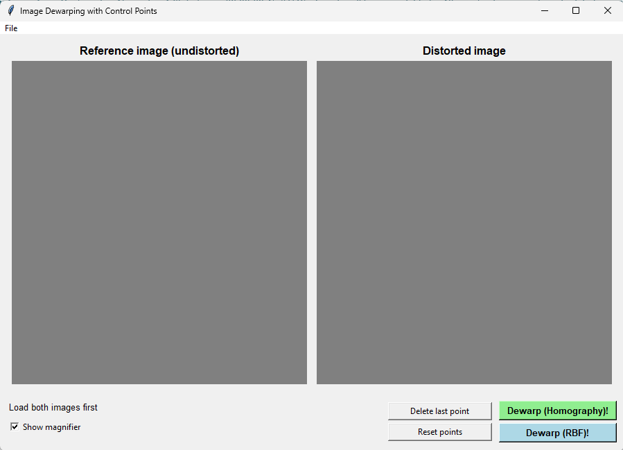
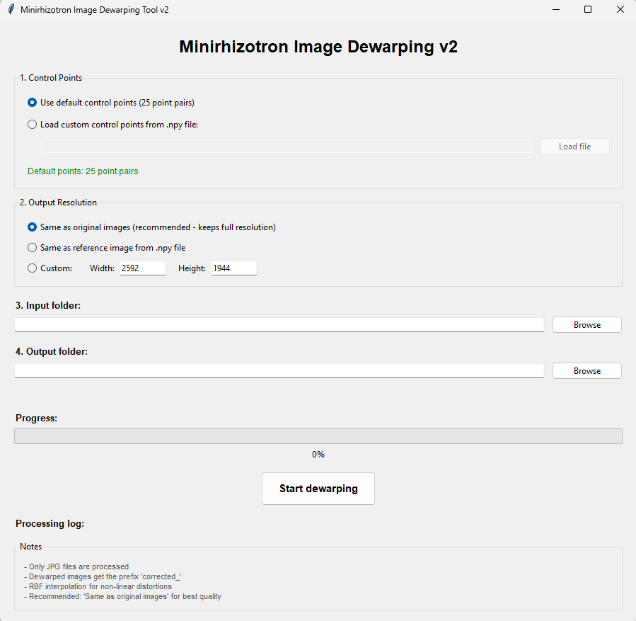
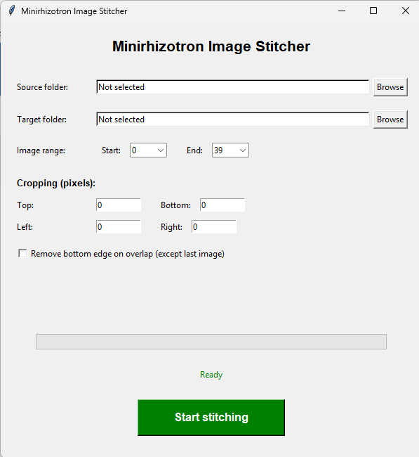

# RhiZimon Image Processing Pipeline

[](https://doi.org/10.5281/zenodo.24284874)

A three-step GUI-based pipeline for dewarping and stitching minirhizotron images.
Minirhizotron cameras typically produce images with lens-induced distortion and 
perspective warping. This toolset allows users to calibrate a correction, apply it 
in batch, and stitch the results into continuous root profiles.

---

## Requirements

Python 3.8+ and the following packages:

```bash
pip install opencv-python numpy scipy Pillow matplotlib
```

---

## Pipeline Overview

| Step | Script | Description |
|------|--------|-------------|
| 1 | `transformCalibration.py` | Interactively define control points and export a calibration file |
| 2 | `imageTransform.py` | Batch-dewarp images using the calibration file |
| 3 | `imageStitch.py` | Stitch dewarped image series into composite images |

---

## Scripts

### `transformCalibration.py` — Calibration

An interactive GUI tool for generating the `.npy` calibration file required by the 
pipeline. The user loads a reference (undistorted) image alongside a distorted image 
and manually places corresponding control point pairs on both canvases. Points can be 
added, repositioned, and removed, with a magnifier overlay for precise placement. 
The exported calibration file contains the point pair mappings and image dimensions 
used in the dewarping step. Both homography-based and RBF-based preview corrections 
are supported within the tool.



### `imageTransform.py` — Dewarping

A batch-processing GUI tool that applies RBF (Radial Basis Function) thin-plate spline 
dewarping to a folder of distorted images. The transformation can be driven either by 
a default set of 25 built-in control point pairs or by a custom `.npy` calibration file 
generated with `transformCalibration.py`. The mapping grid is computed once and reused 
across all images in the batch. Output resolution can be set to match the original 
images, the reference image from the calibration file, or a custom size.



### `imageStitch.py` — Stitching

A GUI tool for batch-stitching dewarped minirhizotron image series into single composite 
images. Image series are detected automatically by filename pattern. The user can select 
a frame range, configure per-side pixel cropping to remove borders or overlapping areas, 
and optionally strip the bottom edge of intermediate frames to avoid overlap seams. Each 
detected series is exported as a separate JPEG file.



---

## Repository Structure

├── code/    # Source code

└── docs/    # Screenshots

---

## Citation

If you use this software in your research, please cite it as:

> Thomsen, S. (2026). *RhiZimon Image Processing Pipeline* (Version 1.0.2) [Computer software]. Zenodo. https://doi.org/10.5281/zenodo.24284874

Citation metadata is also provided in [`CITATION.cff`](CITATION.cff).

---

## License


This project is licensed under the MIT License.  
Copyright (c) 2025 [Simon Thomsen]

